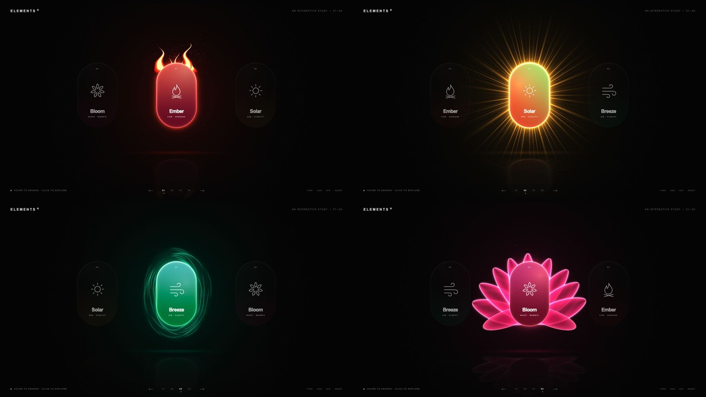

# Particle Button · Elements

参考视频复刻的四元素粒子按钮，使用 **Three.js + WebGL / GLSL ShaderMaterial** 实时渲染。

[在线体验 / Live Demo](https://jdb156158.github.io/particleButton/)

[](https://jdb156158.github.io/particleButton/)

点击上方预览图即可打开交互演示。

- **Ember**：程序化火焰、上升余烬、红色光晕。
- **Solar**：金色日冕、放射光束、闪烁粒子。
- **Breeze**：环绕气流、青绿色流光。
- **Bloom**：层叠发光花瓣、粉色微粒。
- 胶囊表面、泛光和地面倒影均在片元着色器中绘制；880 个粒子由 GPU 顶点着色器驱动。

## 运行

在项目根目录运行：

```sh
python3 -m http.server 4173 --directory dist
```

打开 http://localhost:4173。所有依赖已放在 `dist/vendor`，不依赖 CDN，也不需要构建。

悬停唤醒元素，点击按钮切换到中央。也可使用底部导航、左右方向键，或在手机上左右滑动。

## 文件

- `dist/index.html` / `dist/style.css`：界面与响应式布局。
- `dist/app.js`：Three.js 场景、粒子和轮播交互。
- `dist/shaders.js`：胶囊、四种特效、倒影与粒子着色器。
- `dist/vendor/`：Three.js r180，MIT License。

默认尊重系统减少动态效果设置。需要支持 WebGL 的浏览器。

## 已验证

- 桌面 1280×720 与窄屏 390×844 的实际浏览器渲染。
- 四种元素切换、底部导航、左右方向键。
- 连续切换 12 次后，中心位置正确，保持三个可见按钮。
- JavaScript 语法检查、Git 空白检查通过，修复后浏览器没有新增着色器错误。
- 手机滑动已实现，尚未在真实触屏设备上验证。

## 自动发布

推送到 `main` 后，GitHub Actions 会检查 JavaScript 并将 `dist/` 自动部署到 GitHub Pages；也可在 Actions 页面手动运行发布工作流。
